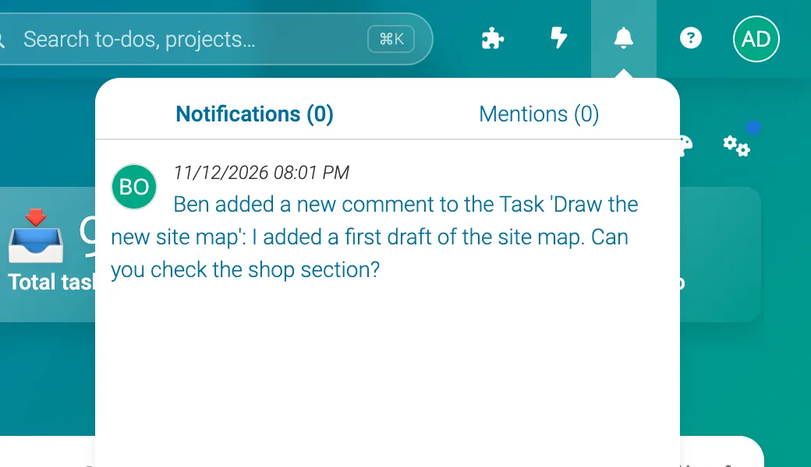
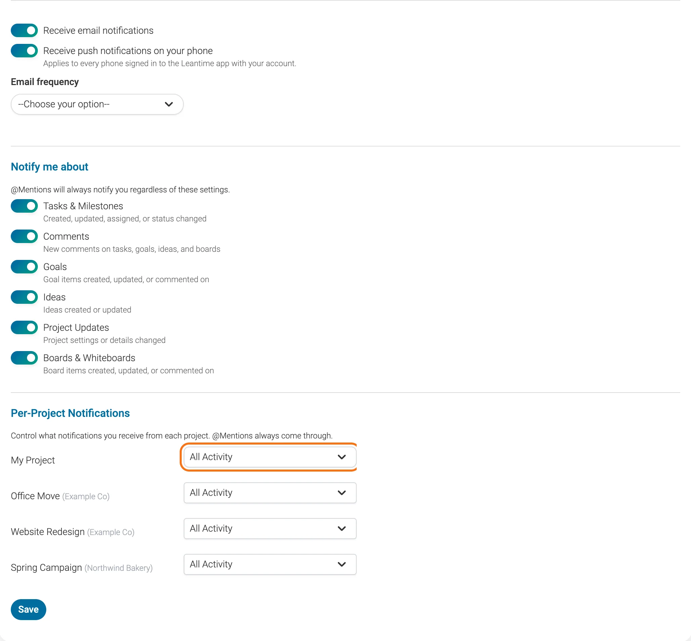

# Notifications

Leantime tells you when something changes in your projects: a new comment, a to-do assigned to you, a status change. You see notifications under the bell at the top of the screen, and by email if you want them. You choose what you hear about, and how much, in your profile.

## Where do I see my notifications?

Click the bell at the top right. **Notifications** lists recent changes in your projects. **Mentions** lists the times someone wrote your name with @, like `@Ada`.

Click a notification to open what it's about.

## How do I choose which notifications I get?

1. **Click your profile picture** at the top right, then **My Profile**.
2. **Open the Notifications tab.**
3. **Choose your settings** (explained below).
4. **Click Save.**

| Setting | What it does |
|---|---|
| **Receive email notifications** | Sends your notifications by email as well |
| **Receive push notifications on your phone** | Sends them to the Leantime mobile app, on every phone you're signed in on |
| **Email frequency** | The shortest wait between two update emails. Leantime collects what happens in between into one email, and doesn't send it if you've already read everything in Leantime |
| **Notify me about** | Switches for each kind of change: Tasks & Milestones, Comments, Goals, Ideas, Project Updates, and Boards & Whiteboards |
| **Per-Project Notifications** | How much you hear from each project (see below) |

@Mentions always reach you, whatever you switch off.

## How do I get fewer notifications from a busy project?

Change the project's level under **Per-Project Notifications**:

- **All Activity:** everything in the project that matches your **Notify me about** switches.
- **My Work Only:** only changes to things you're assigned to, created or are directly involved in.
- **Muted:** nothing from this project, except @mentions.

## Can I get notifications in Slack, Teams or another tool?

- **For a whole project:** a Manager can connect the project to Slack, Mattermost, Zulip, Telegram or Discord on the **Integrations** tab of its settings. Leantime then posts the project's updates to a channel. See [Project Integrations](using-leantime/integrations.md).
- **For just you:** the **Webhooks** tab in **My Profile** sends your notifications to a web address of your own, as JSON. It follows your notification settings, even with email switched off.

## How do administrators set the defaults?

Administrators set these in **Company → Company Settings**:

- **Email frequency:** the shortest wait for everyone. People can choose a longer wait in their own settings, not a shorter one.
- **Default notification types for new users** and **Default notification level:** what people get until they change their own settings.

## What if something goes wrong?

- **I don't get any emails.** Check that **Receive email notifications** is on and the project isn't **Muted**. If nobody gets emails, an administrator needs to check the [email settings](installation/email-configuration.md).
- **Emails arrive late.** **Email frequency** sets the shortest wait between emails, and the company setting can make it longer. Self-hosted Leantime also sends emails from its scheduled jobs, so they need a [cron job](installation/configuration.md#cron-jobs) or someone signed in.
