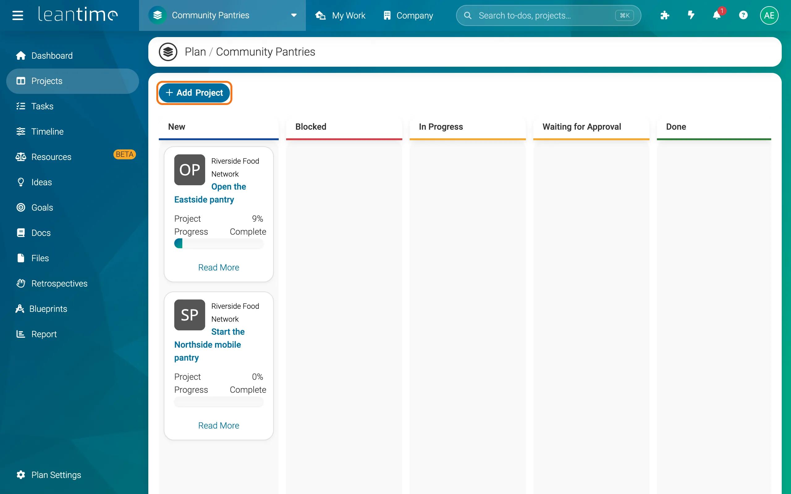
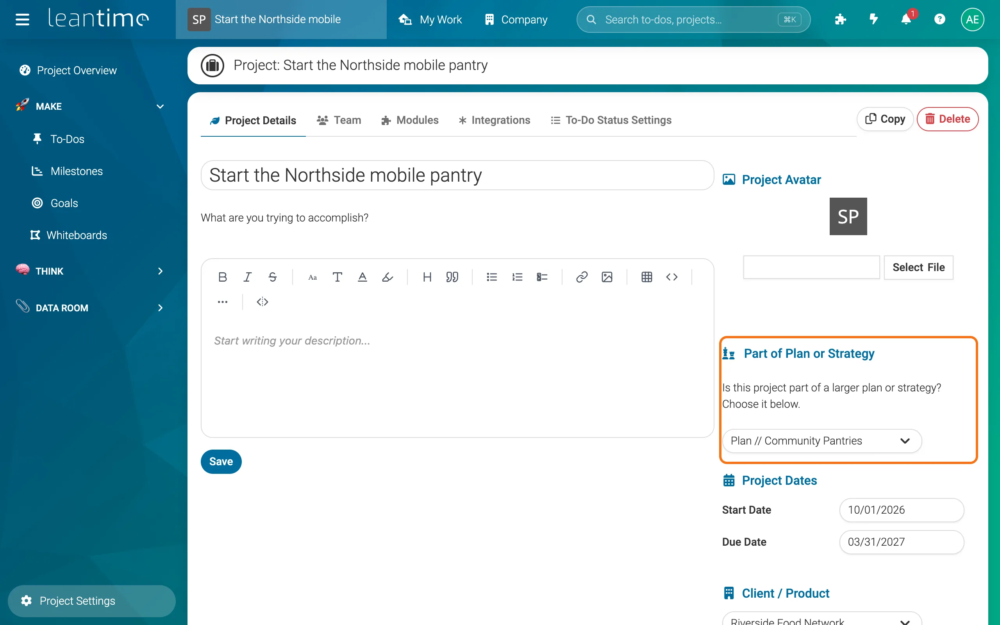
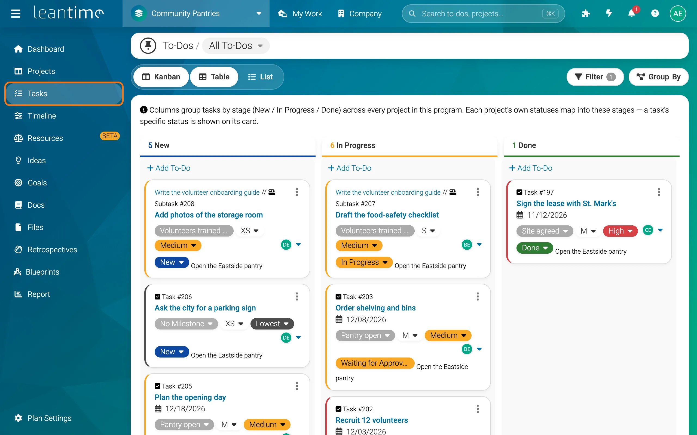
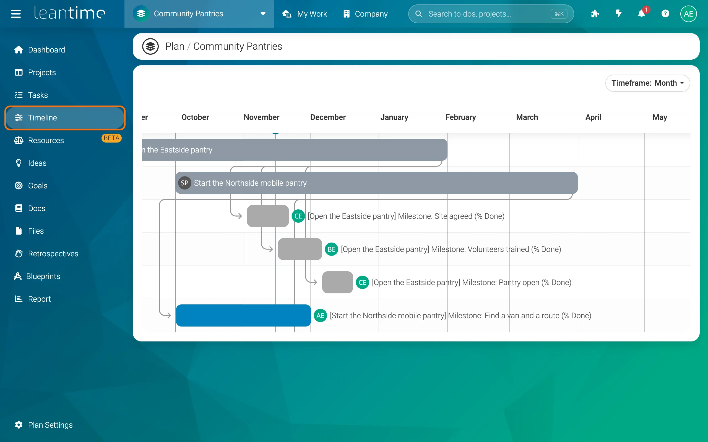
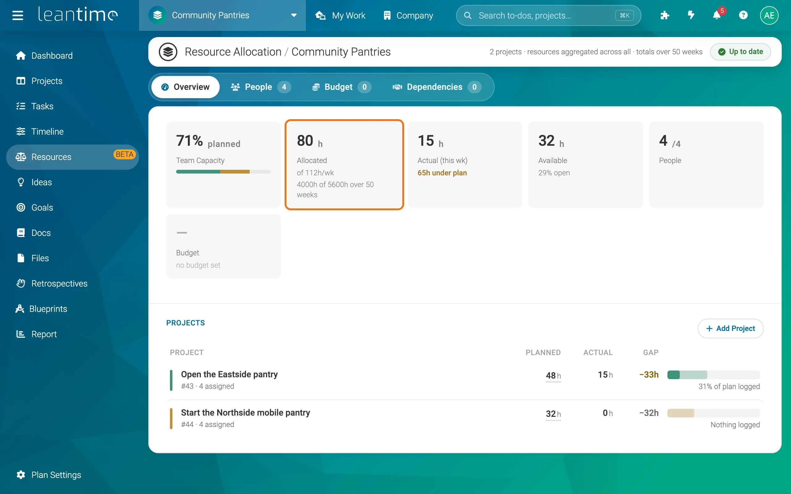

# Programs

A program groups projects that work toward the same result, like "Community Pantries" with a project for each new pantry. A program gives the group a place of its own: every project's to-dos on one board, every milestone on one timeline, and shared goals and sprints.

Use it when you run several related projects and keep switching between them to see where things stand.

Some screens still say "Plan" where they mean a program, like **Plan Settings**. Plan and program are the same thing, so this page gives both names.

Programs come with the [Programs](plugins/programs.md) plugin. On Leantime Cloud it's already on; on your own server, see [Programs](plugins/programs.md) to install it.

## How do I create a program?

1. **Open the project menu** at the top of the page and click **Start something new**.
2. **Click Create a Program.**
3. **Enter the title** and fill in **What are you trying to accomplish?**
4. **Choose the client** under **Client / Product**. Every program belongs to a client, like a project does.
5. **Optional:** set a **Start Date** and **Due Date**.
6. **Choose who can see it** under **Who can access this program?**: only the people you choose under **Team**, everyone assigned to the client, or everyone in your organization.
7. **Click Save.**

Creating a program needs the Editor role or higher. Changing its **Program Settings** (or **Plan Settings**) needs Manager or higher.

A program has its own menu: **Dashboard**, **Projects**, **Tasks**, **Timeline**, **Resources** (in beta), **Ideas**, **Goals**, **Docs**, **Files**, **Retrospectives**, **Blueprints**, **Report** and, at the bottom, **Program Settings** (or **Plan Settings**).

## How do I add projects to a program?

- **A new project:** open **Projects** in the program's menu and click **Add Project**. The new project starts out in the program.
- **A project you already have:** open the project, click **Project Settings**, choose the program under **Part of Program or Strategy** (or **Part of Plan or Strategy**), and click **Save**.

A project belongs to one program at a time. A program can itself sit under a [strategy](using-leantime/strategies.md): choose the strategy under **Part of Program or Strategy** (or **Part of Plan or Strategy**) in **Program Settings**.

## How do I see all of the program's work?

- **Dashboard:** a card for each project, with its progress, status and team.
- **Projects:** the projects as a board, with a column for each project status.
- **Tasks:** every to-do from every project in the program, as **Kanban**, **Table** or **List**. The Kanban columns group to-dos by stage (New, In Progress and Done), so projects with their own statuses still line up; each card shows its project and its own status.
- **Timeline:** every project and its milestones on one chart. Change the scale with **Timeframe**: day, week or month.

## Can projects in a program share sprints?

Yes. A sprint created in the program shows up in each of its projects, so the whole program can work to the same schedule. Edit or delete it in the program; it can't be changed from inside a project.

## How do program goals work?

A program has its own **Goals**, like a project does (see [Goals](using-leantime/goals.md)). If the program is part of a [strategy](using-leantime/strategies.md), the program's goals and its projects' goals can report into the strategy's goals, so the strategy's numbers move as the work gets done.

## How do I plan people's time with Resources?

**Resources** (in beta) shows whether the program has the people for its work: how many hours each person has, how many they're booked for on each project, and how much time they've logged this week. It also keeps the program's budget lines and outside partners it depends on.

1. **Click Resources** in the program menu. The first time, Leantime adds everyone on the program's projects for you. To add someone else, use **Add Person** on the **People** tab.
2. **Book their hours:** on the **People** tab, click the bar next to a person, enter the hours a week they'll spend on each project, and click **Done**.
3. **Read the totals** on the **Overview** tab:
   - **Allocated:** the hours booked, out of everyone's weekly hours added together.
   - **Actual (this wk):** the time logged this week on the program's to-dos.
   - **Projects:** planned against logged hours for each project.

### Where do each person's hours come from?

- **From their user:** the **Weekly hours** an administrator sets under **Company → User Management** (see [User Management](using-leantime/user-management.md)). Resources shows the number as plain text; to change it, change it on their user.
- **Typed on the People tab:** for people without weekly hours on their user, or who aren't Leantime users. New people start at 40.

The **Employment type** on their user shows as a badge next to the hours: **FTE**, **PT**, **Contract** or **Volunteer**.

### Does it count hours across projects and programs?

Yes. A person's hours are added up across all the projects in the program. If another program's Resources books them too, the People tab shows those hours as "8h elsewhere", and they count against the person's weekly hours as well. It doesn't say which program, so no one sees work on programs they can't open.

When the total goes past their weekly hours, the People tab shows how far over they are, like "4h over capacity".

Only hours booked on Resources count. Time estimates on to-dos, and projects that aren't in a program, don't.

## What's in the program Report?

**Report** sums up a period across all the program's projects: milestones, goals and hours, what needs attention, people and capacity from the **Resources** plan, and the program's Logic Model. See [What's in a program or strategy report?](using-leantime/reports.md#whats-in-a-program-or-strategy-report)

## Related

- [Programs: install and set up](plugins/programs.md)
- [Strategies](using-leantime/strategies.md)
- [Projects](using-leantime/managing-projects.md)
- [Milestones](using-leantime/roadmap-planning.md)
- [How should I organize my work?](getting-started/organize-your-work.md)
- [All plugins](installation/using-plugins.md)
