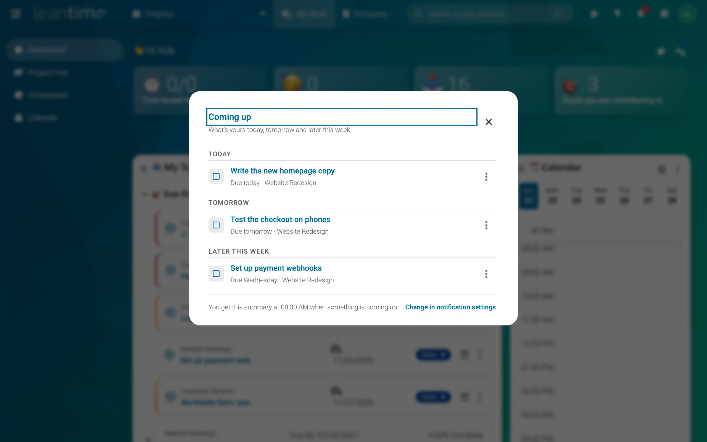
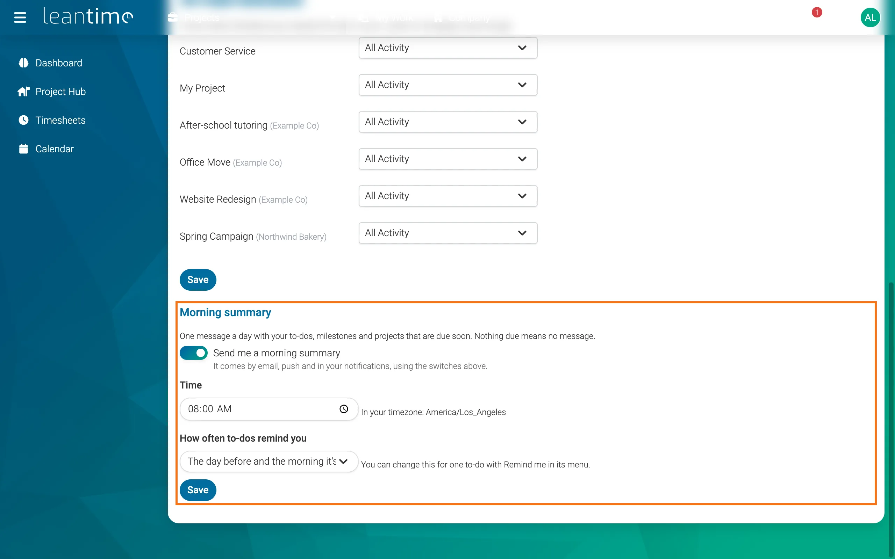

# Reminders and the morning summary

Leantime looks ahead for you. Once a day, it sends you a short morning summary of what's coming up: your to-dos that are due, milestones about to end and, for project managers, projects about to end. When nothing is coming up, it sends nothing.

Reminders are in Leantime 3.17 and later, and on Leantime Cloud.

## What's in my morning summary?

- **Your to-dos that are due soon.** Yours are the to-dos assigned to you, and unassigned to-dos you created. When each one shows up depends on its reminder (see [How do I choose how often a to-do reminds me?](#how-do-i-choose-how-often-a-to-do-reminds-me)).
- **Milestones you own,** a week before and the day before they end.
- **Projects ending,** a week before and the day before, for the project's managers. If nobody on the project is a manager, everyone on it gets them.
- **To-dos that repeat every day or every weekday and are due today,** as one line, like "Routine tasks today: 3". If you chose an earlier reminder for one of them, the days before it's due list it on its own, like any other to-do.
- **To-dos that were due earlier and are still open,** as one quiet line, like "2 still open from earlier". They're never listed one by one, and on their own they don't send a summary.

The summary lists up to 5 items, most urgent first, and says how many more there are. Done to-dos, closed projects, and anything you can't see in Leantime are left out.

## Where does it arrive?

At 08:00 in your time zone, unless you choose another time:

- **In the bell,** pinned under **Today**: "Your morning summary: 1 due today, 1 due tomorrow".
- **By email,** with the subject "Coming up: …", if you get email notifications.
- **On your phone,** if you get phone notifications (see [Leantime on your phone](using-leantime/mobile-app.md)).

Click the summary, or **See what's coming up** in the email, to open the **Coming up** panel. It has everything, not only the first 5, grouped into **Today**, **Tomorrow**, **Later this week** and **Later**. Each row's **⋮** menu changes that to-do's reminder.

## How do I change the time or turn it off?

1. **Click your profile picture** at the top right, then **My Profile**.
2. **Open the Notifications tab** and scroll to **Morning summary** at the bottom.
3. **Change the settings** and click the **Save** under them:
   - **Send me a morning summary:** switch it off to stop the summary and all reminders.
   - **Time:** when the summary comes, in your time zone (see [How do I change my language, date format or time zone?](using-leantime/account-settings.md#how-do-i-change-my-language-date-format-or-time-zone)).
   - **How often to-dos remind you:** your default for your to-dos. You can choose differently for one to-do. To-dos that repeat every day or every weekday remind you only the morning they're due, whatever this default, unless it's **Don't remind me**.

Whether the summary comes by email or on your phone follows the **Receive email notifications** and **Receive push notifications** switches above it (see [Notifications](using-leantime/notifications.md)).

## How do I choose how often a to-do reminds me?

Open the to-do's **⋮** menu (on its card, at the top of the open to-do, or in the **Coming up** panel) and choose **Remind me**:

| Choice | When the to-do shows in your summary |
| --- | --- |
| **The day before and the morning it's due** | The usual choice, and the starting default |
| **Every morning until it's due** | Every morning from its start date, or from 3 days before it's due when it has none. Always the day before and the morning it's due too |
| **Only the morning it's due** | Just that morning |
| **Don't remind me** | Never |

The menu shows the current choice, like **Remind me: Day before**, and marks your default with **Your default**. When you pick something other than the reminder one of your own to-dos already follows, **Use this for all my to-dos** appears and makes that choice your default. To change your default at any time, use **How often to-dos remind you** in the Morning summary settings (see [How do I change the time or turn it off?](#how-do-i-change-the-time-or-turn-it-off)).

- **A to-do needs a due date** to remind you.
- **Someone else's to-do:** if you can see it, pick a reminder to add it to your own summary. It doesn't remind the person it's assigned to.
- **Repeating to-dos:** with the [Recurring To-Dos](plugins/recurring-todos.md) plugin 1.4.0 or later, each new copy keeps everyone's reminder choice.

## Can an administrator turn reminders off for everyone?

Yes. In **Company Settings**, on the **Details** tab, switch off **Send morning summaries** under **Reminders**, and click the **Save** under it. You need the Administrator or Owner role. Nobody gets a summary or reminders then. People see "An admin turned morning summaries off for this workspace" in their own settings.

## What does it need on my own server?

- **Leantime's scheduled jobs.** The summary is sent by the `reminders:dispatch` job, which runs every 5 minutes (see [Scheduled jobs, the queue and Redis](installation/scheduled-jobs-and-redis.md)). If the jobs haven't run in the last hour, the **Morning summary** settings show Administrators and Owners "Reminders aren't going out" with the cron command to set up. Other people don't see this warning, so ask an administrator to check. The official Docker image runs the jobs for you.
- **Email,** for summaries by email (see [Email configuration](installation/email-configuration.md)).
- **Phone notifications,** for summaries on phones (see [Set up the mobile app](installation/mobile-app-setup.md)).

A summary goes out within three hours after each person's chosen time, and no later than midnight in their time zone. If the scheduled jobs don't run in that window, that day's summary is skipped.

## What if I don't get a summary?

- **Nothing was coming up.** No due to-dos, milestones or projects ending means no message.
- **It's switched off,** for you under **My Profile → Notifications**, or for everyone in **Company Settings**.
- **The to-do has no due date,** or its reminder is **Don't remind me**.
- **The to-do isn't yours:** choose a reminder for it with **Remind me**.
- **It came at the wrong time:** check your time zone under **My Profile → Settings**.
- **No email:** check the **Receive email notifications** switch, and on your own server, your email settings.
- **On your own server:** check that the scheduled jobs run (see above).

## Can my AI assistant use reminders?

Yes. With the [MCP server](installation/leantime-mcp.md), your assistant can read what's coming up for you, choose a to-do's reminder and change your summary settings. On your own server, that needs MCP Server plugin 2.1.0 or later.

## Related

- [Notifications](using-leantime/notifications.md)
- [To-Dos](using-leantime/task-management.md)
- [My Work dashboard](using-leantime/my-work-dashboard.md)
- [Your account and settings](using-leantime/account-settings.md)
