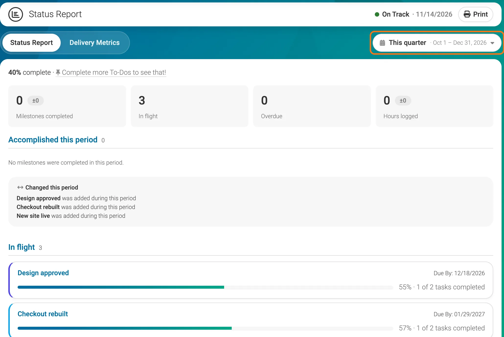
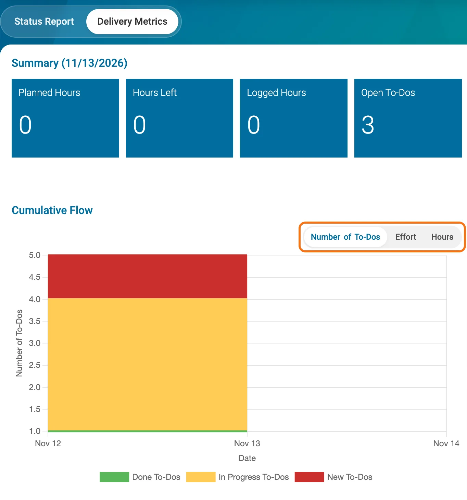

# Reports

Reports answer "how is this project going?" in one place: what got done, what's in progress, what's coming, and whether the goals are moving. Use them for a weekly check-in, a client update or a board meeting, or just to see your progress add up.

## How do I see a project's report in Leantime?

Open the project, open **Data Room** in the left menu and click **Reports**. The **Status Report** opens first. The second tab, **Delivery Metrics**, has the numbers behind the work.

## What's in the Status Report?

**At the top:** the project's status from its latest [project update](using-leantime/managing-projects.md#whats-on-the-project-overview) (**On Track**, **At Risk** or **Off Track**) and a **Print** button.

**The period.** The report covers one period at a time. Choose it at the top right: **last quarter**, **this quarter**, **next quarter**, or your own dates.

**The numbers:** how much of the project is done, then **Milestones completed**, milestones **In flight**, **Overdue** milestones and **Hours logged** in the period. The small badge next to a number shows the change from the period before.

**The sections below them:**

- **Needs attention** appears when something needs a look, like an overdue milestone or a goal at risk.
- **Accomplished this period:** the milestones finished in the period. This is the part to share when someone asks what got done.
- **Changed this period:** milestones that were added during the period, or whose due date moved out of it. It keeps the report honest about plans that changed.
- **In flight:** the milestones being worked on, with their due dates and how far along they are.
- **Coming up:** milestones planned for the periods after this one.
- **Goals & KPIs:** each [goal](using-leantime/goals.md) with its number, its progress and the milestones linked to it.
- **Status updates:** the project updates posted in the period.

## What's in Delivery Metrics?

- **Summary:** planned hours, hours left, logged hours and open to-dos.
- **Cumulative Flow:** how many to-dos were new, in progress and done on each day. Switch between **Number of To-Dos**, **Effort** and **Hours** above the chart. A band that keeps growing while **Done** stays flat means work is piling up.
- **Project Progress:** done and open to-dos as a ring.
- **Milestones:** each milestone's due date and progress.

Planned and logged hours only show numbers when the team plans and [tracks time](using-leantime/timesheets.md) on their to-dos.

How a to-do counts as new, in progress or done comes from its status's **Report As** setting (see [How do I change the to-do statuses?](using-leantime/managing-projects.md#how-do-i-change-the-to-do-statuses)).

## How do I share a report?

Click **Print** at the top of the Status Report. Your browser's print window opens, where you can print it or save it as a PDF to send.

## What if something goes wrong?

- **I don't see Reports in the left menu.** Reports may be switched off for this project on the **Modules** tab of **Project Settings** (see [How do I switch features on or off for a project?](using-leantime/managing-projects.md#how-do-i-switch-features-on-or-off-for-a-project)).
- **The top of the report says "No update".** Nobody has posted a project update yet. Post one on the Project Overview with **Update Status**.
- **Done to-dos don't count as done.** Check the **Report As** setting of the status they're in.
- **Hours show 0.** Nobody has logged time on this project's to-dos in the period, or Time tracking is switched off for the project.
