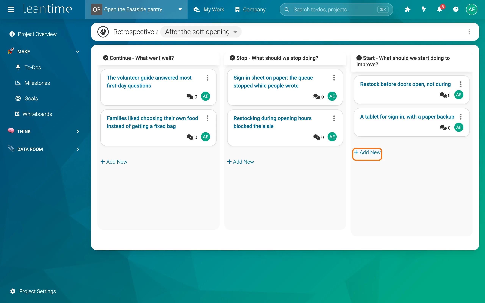

# Retrospectives

A retrospective is a short look back with the team, after a sprint, a milestone or an event: what worked, what didn't, and what to try next time. Leantime gives each project a Retrospective board to collect the answers and keep them for later.

## How do I hold a retrospective in Leantime?

1. **Open the project** and click **Retrospectives** in the left menu, under **Think**.
2. **Start a board for this retrospective:** click the board name at the top, choose **Create New Board**, enter a title like "After the soft opening" and click **Create Board**. Each board needs its own title.
3. **Add cards to the three columns** with **Add New**:
   - **Continue - What went well?**
   - **Stop - What should we stop doing?**
   - **Start - What should we start doing to improve?**
4. **Give each card a title**, and a description if it needs one. Click **Save & Close**.
5. **Talk it through.** Each card has its own **Discussion** for comments.

A board called **Board** is made for you the first time you open Retrospectives; rename it or use it for your first one.

Adding cards needs the Editor role or higher. Commenters can join the discussion.

## How do I make sure the changes happen?

A retrospective only helps if something changes. For each card under **Start**:

- **Open the card** and use **Linked Milestone** to create a milestone for the change, or link it to one you already have.
- **Add to-dos** to that milestone for the work.
- **Look back** at the last board at the start of your next retrospective: did it happen?

## Where else do I find retrospectives?

Retrospectives is one of the [Blueprints](using-leantime/blueprints.md). From a board's **⋮** menu at the top right, you can **Edit** its title, **Export** or **Print** it, or **Delete** it.

## Related

- [Agile](knowledge-base/agile.md): reflecting and adjusting after each cycle
- [Lean](knowledge-base/whatislean.md): continuous improvement
- [Milestones](using-leantime/roadmap-planning.md)
