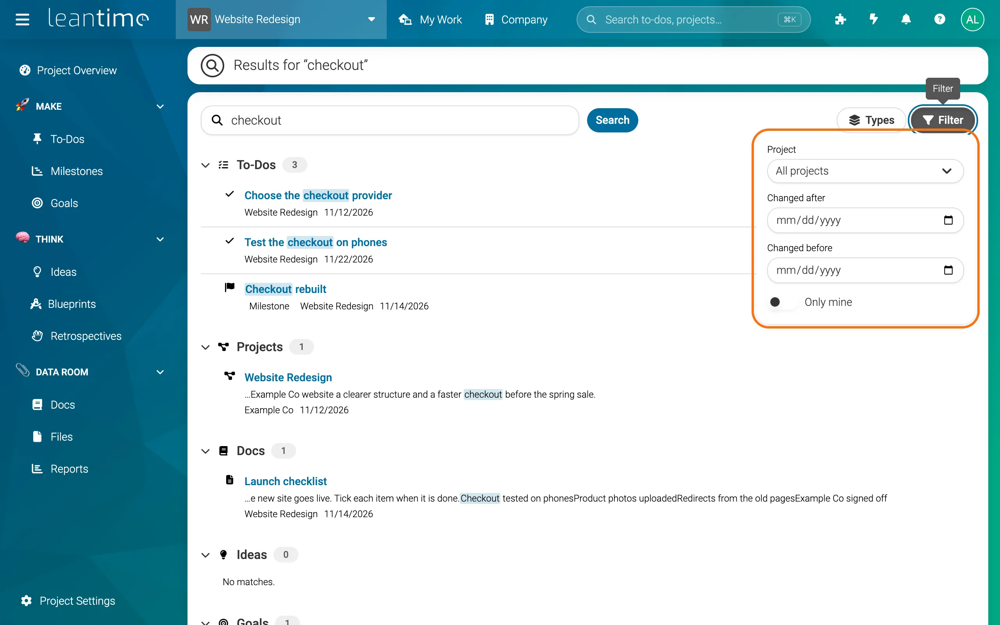

# Search

Search finds to-dos, projects, docs, ideas, goals, Blueprint cards, comments, files and people across every project you can see. It's the box at the top of every page.

## How do I search?

1. **Click the search box** at the top, or press **⌘K** (Mac) or **Ctrl+K** (Windows and Linux). **/** works too, when you're not typing somewhere else.
2. **Type at least two characters.** Results show as you type, grouped by type: To-Dos, Projects, Docs and so on.
3. **Click a result to open it,** or use the arrow keys and press **Enter**.

To see everything, press **Enter** without choosing a result, or click **See all results**. **Escape** closes the results.

## How does Leantime match my words?

Every word you type has to match, so `checkout phones` finds "Test the checkout on phones" but not "Choose the checkout provider". Very common words like "the", "on" or "for" can be skipped, so `the roadmap` also finds "Roadmap review". Leantime uses up to five words.

| Type | What Leantime looks in |
| --- | --- |
| **To-Dos** | Headline, description and tags. Milestones and subtasks are found too, marked **Milestone** or **Subtask** |
| **Projects** | Name, description and client, for projects, strategies and programs |
| **Docs** | Title and text. Drafts are found only by their author |
| **Ideas, Goals, Blueprints** | Title, text and tags. Blueprint boards are found by name |
| **Comments** | The comment text, shown with the to-do, doc or idea it's on |
| **Files** | File name |
| **People** | Name, email, job title and department, for active users. Only Administrators and Owners can search for people |

## How do I narrow down the results?

On the results page:

- **Types:** tick the kinds of results you want.
- **Filter:**
  - **Project** limits the results to one project. People results aren't limited by it: they show everyone who matches, not only the project's team.
  - **Changed after** and **Changed before** limit them to things changed in that period.
  - **Only mine** keeps to-dos assigned to you or created by you, and the docs, ideas, cards, comments and files you wrote or uploaded.
- **Reset filters** clears them.

Each type shows its first results; click **Load more** under it for the rest.

## Why can't I find something?

- **It's in a project you're not on.** Search only looks in projects you can open (see [Who can see a project in Leantime?](using-leantime/managing-projects.md#who-can-see-a-project-in-leantime)).
- **The feature is switched off in that project.** When a project switches off Ideas, Goals, Blueprints or Docs, their results don't show (see [How do I switch features on or off for a project?](using-leantime/managing-projects.md#how-do-i-switch-features-on-or-off-for-a-project)).
- **The project is closed.** Nothing from a closed project shows in the results: not the project, its to-dos, docs or comments.
- **Not every word matches.** Try fewer words, or part of a word.
- **It's someone's draft doc.** Drafts are only found by their author.

## Related

- [To-Dos](using-leantime/task-management.md)
- [Docs](using-leantime/docs.md)
- [Projects](using-leantime/managing-projects.md)
