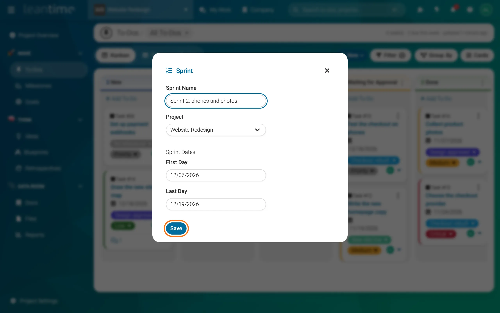
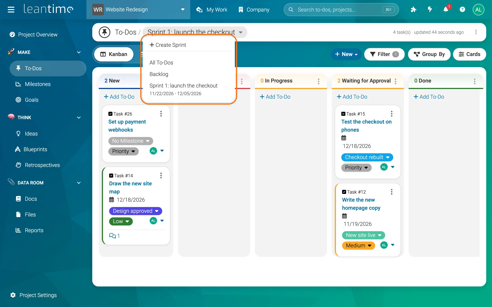
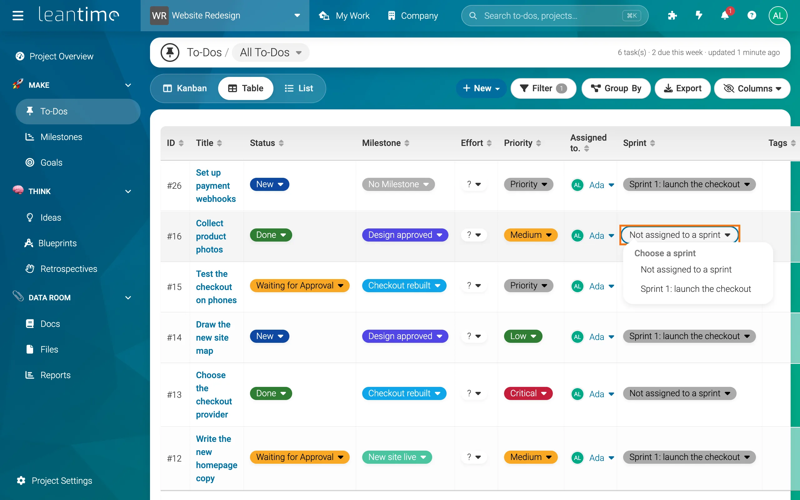

# Sprints

A sprint is a fixed stretch of time, often two weeks, with the to-dos your team plans to finish in it. When it ends, you look at what got done and plan the next one. To-dos that aren't in a sprint wait in the **Backlog**.

Sprints are optional. Many teams work from one board without them. To decide whether they suit your team, see [Scrum](knowledge-base/scrum.md) and [Kanban](knowledge-base/kanban.md).

## How do I create a sprint?

1. Open the project and click **To-Dos** in the left menu.
2. Click the name next to **To-Dos** at the top of the page (it reads **All To-Dos** at first), then **Create Sprint**.
3. Give the sprint a name, like "Sprint 1: launch the checkout".
4. Check **First Day** and **Last Day**. Leantime suggests today until two weeks from now.
5. Click **Save**, then close the window.

## How do I switch between sprints and the backlog?

Click the name next to **To-Dos** at the top of the page. The menu has:

- **All To-Dos:** every to-do in the project, in a sprint or not.
- **Backlog:** the to-dos that aren't in any sprint.
- **Each sprint,** with its dates.

Your choice applies to the Kanban, Table and List views, and Leantime keeps it while you move around. The number of to-dos in the view shows at the top right.

## How do I put to-dos in a sprint?

- **Add them while the sprint is open.** With a sprint chosen at the top, a to-do you add with **Add To-Do** on the board goes into that sprint.
- **Use the Table view.** Click **Table**, then the **Sprint** of a to-do, and choose the sprint. This is the quickest way to move several to-dos from the backlog.
- **Open the to-do** and choose a **Sprint**.

To take a to-do out of a sprint, choose **Not assigned to a sprint**. It goes back to the backlog.

To see the sprint on the board in other ways:

- **Group By → Sprint** gives each sprint its own lane.
- **Cards → Sprint** shows the sprint's name on each card.

## How do I follow a sprint's progress?

Open **Reports** (under **Data Room** in the left menu) and click **Delivery Metrics**. **Sprint Burndown** shows how much work is left in the sprint each day, next to a straight line to zero at the end of the sprint. Pick the sprint above the chart, and switch between **Number of To-Dos**, **Effort** and **Hours**.

- The chart grows one point a day. Leantime takes a snapshot of each project once a day, so a new sprint's chart stays empty until the first snapshot.
- The starting point is the first day's snapshot. Put the to-dos in the sprint before it starts, so the chart starts from the full amount.
- **Effort** and **Hours** only show numbers when the to-dos have an effort, or hours remaining.
- On a self-hosted server, the daily snapshot needs Leantime's [cron job](installation/configuration.md#cron-jobs).

## What happens when a sprint ends?

Nothing changes on its own. To-dos that aren't done stay in the old sprint. To carry them over:

1. [Create the next sprint](#how-do-i-create-a-sprint).
2. Open the old sprint, click **Table**, and move each open to-do to the new sprint, or back to the backlog.

Then look back with the team: what worked, and what to change next time. See [Retrospectives](using-leantime/retrospectives.md).

## How do I change or delete a sprint?

Open the sprint from the menu at the top, then click the **⋮** at the top right of the page:

- **Edit Sprint** changes its name or dates.
- **Delete Sprint** removes the sprint. Its to-dos aren't deleted: they go back to the backlog.

A sprint marked **Program Sprint** belongs to the program the project is in. Change or delete it in the program (see [Can projects in a program share sprints?](using-leantime/programs.md#can-projects-in-a-program-share-sprints)).

## Who can do what with sprints?

| Role in the project | Sprints |
| --- | --- |
| Read Only and Commenter | See sprints and switch between them |
| Editor and above | Create, edit and delete sprints, and move to-dos in and out |

See [User Management](using-leantime/user-management.md) for what each role does.

## Related

- [To-Dos](using-leantime/task-management.md)
- [Scrum](knowledge-base/scrum.md)
- [Reports](using-leantime/reports.md)
- [Retrospectives](using-leantime/retrospectives.md)
- [Programs](using-leantime/programs.md)
