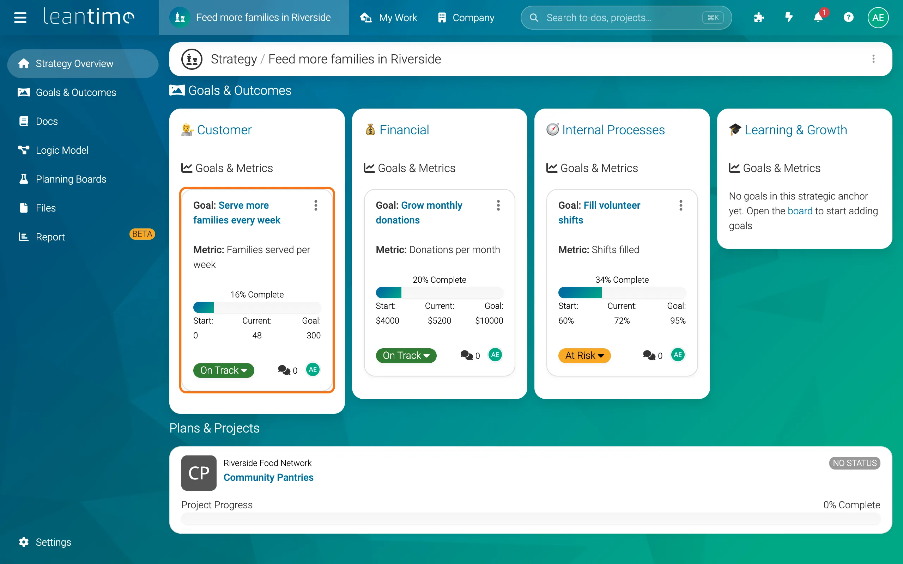
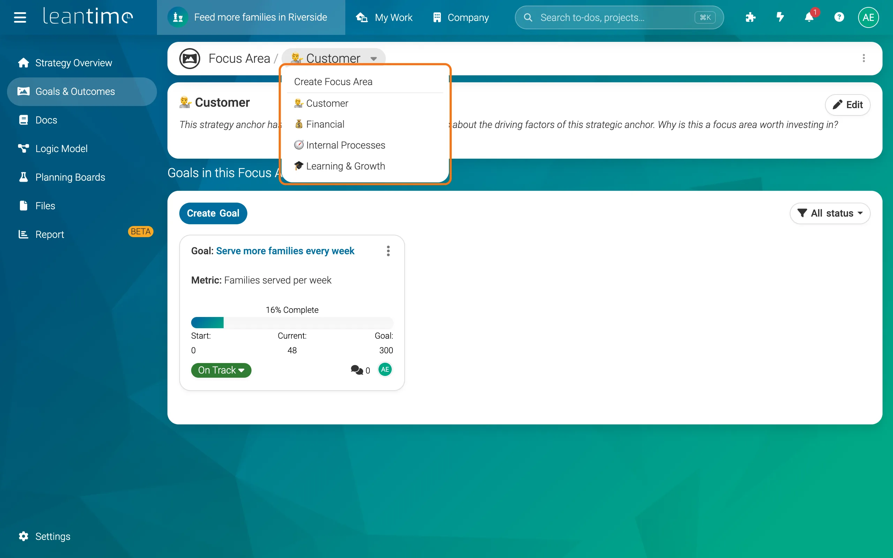

# Strategies

A strategy is what your organization is working toward over the next year or more, like "Feed more families in Riverside". A strategy gives it a place of its own above your projects: focus areas, goals you can measure, and the programs and projects that do the work.

Use it when several projects serve the same bigger aim, and you want to see whether that aim is moving. For one project on its own, [project goals](using-leantime/goals.md) are enough.

Strategies come with the [Strategy Pro](plugins/strategy-pro.md) plugin. On Leantime Cloud it's already on; on your own server, see [Strategy Pro](plugins/strategy-pro.md) to install it.

## How do I create a strategy?

1. **Open the project menu** at the top of the page and click **Start something new**.
2. **Click Create a Strategy.**
3. **Enter the title of your strategy.**
4. **Fill in What are you trying to accomplish?** The box starts with three headings to guide you: Executive Summary, Company Purpose and Strategic Vision. Keep them, change them, or write your own.
5. **Choose who can see it** under **Who can access this project?**: only the people you choose under **Team**, everyone assigned to the client, or everyone in your organization.
6. **Click Save.** The **Strategy Overview** opens.

Creating a strategy needs the Editor role or higher. Changing its settings needs Manager or higher.

A strategy has its own menu: **Strategy Overview**, **Goals & Outcomes**, **Docs**, **Logic Model**, **Planning Boards**, **Files**, **Report** (in beta) and, at the bottom, **Settings**.

## What are focus areas?

Focus areas are the big themes your strategy works on. Every new strategy starts with four, from the balanced scorecard: **Customer**, **Financial**, **Internal Processes** and **Learning & Growth**. Each one gets a card on the Strategy Overview with its goals.

- **To open a focus area,** click **Goals & Outcomes** in the menu. To switch to another one, click its name at the top of the page.
- **To add one,** choose **Create Focus Area** in that same list.
- **To say why it matters,** click **Edit** on the focus area. A sentence or two helps everyone see why it's worth the effort.

## How do I add a goal to my strategy?

1. **Open the focus area** under **Goals & Outcomes** and click **Create Goal**.
2. **Write your goal:** the result you want, like "Serve more families every week".
3. **Fill in What metric will you be using to track this goal?** This is the number you'll count, like "Families served per week".
4. **Choose the type** (a number, a percentage or money) and enter the **Starting Value** and the **Goal Value**.
5. **Optional:** set a **Start Date** and **End Date**, and the **Status**: **On Track**, **At Risk** or **Miss**.
6. **Choose how projects report into it** under **Dependency Reporting** (see the next section).
7. **Click Save.**

## How do my projects' goals count toward the strategy?

A project goal can report into a strategy goal. That way the number on the strategy moves as the projects make progress, and you don't have to add it up yourself.

On the strategy goal, **Dependency Reporting** decides how this works:

| Option | What it does |
| --- | --- |
| **Link & Report** | Programs and projects can link their goals to it, and its **Current Value** is the sum of theirs. You can't type the current value yourself. |
| **Link Only** | Programs and projects can link to it, but you update its current value yourself. |
| **Do not link** | Nothing can link to it. |

Then link the project goals to it from the project: see [Can a project goal count toward a bigger goal?](using-leantime/goals.md#can-a-project-goal-count-toward-a-bigger-goal)

A project can only link to the goals of the strategy it belongs to, directly or through its program, so connect it to the strategy first (see the next section). A program's goals report into the strategy the same way.

## How do I connect a project or program to my strategy?

1. **Open the project** and click **Project Settings** at the bottom of the menu.
2. **Under Part of Program or Strategy (or Part of Plan or Strategy), choose the strategy.**
3. **Click Save.**

A program goes under a strategy the same way, in its **Program Settings** (or **Plan Settings**), and its projects then sit under both. The Strategy Overview shows the programs and projects directly under the strategy in **Programs & Projects** (or **Plans & Projects**), each with its progress.

## What are the Logic Model, Planning Boards and Report?

- **Logic Model** lays out how your work leads to results: what you put in, what you do, what that produces, and the change it makes. In a strategy it connects to the work: build it from your programs, milestones and goals, rate how strong each link is, and turn it into milestones, to-dos and goals. See [Logic Model](blueprints/logic-model.md).
- **Planning Boards** are the [Blueprints](using-leantime/blueprints.md) boards, like a SWOT analysis or a Lean Canvas, for this strategy.
- **Report** (in beta) is a read-out of the strategy for your board or funders: progress, the theory of change, resources across its programs and the journey toward impact. See [What's in a program or strategy report?](using-leantime/reports.md#whats-in-a-program-or-strategy-report)

## Who can see and change a strategy?

- **Who can access this project?** in the strategy's settings decides who can see it.
- **If everyone in your organization can see it,** only the people on the strategy's **Team** can change it. Everyone else can look but not edit.
- **Settings** need the Manager role or higher, and so does deleting a strategy.

## Related

- [Strategy Pro: install and set up](plugins/strategy-pro.md)
- [Programs](using-leantime/programs.md)
- [Goals](using-leantime/goals.md)
- [Blueprints](using-leantime/blueprints.md)
- [How should I organize my work?](getting-started/organize-your-work.md)
- [All plugins](installation/using-plugins.md)
