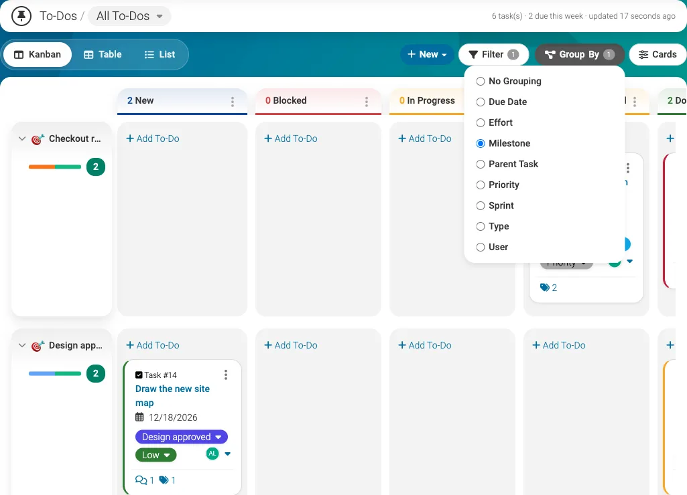

# Kanban swimlanes

Swimlanes split the Kanban board into rows, one per person, milestone, priority or sprint, for example. The status columns stay the same, so you see where each group's work stands at a glance.

In Leantime, swimlanes are under **Group By** on the Kanban board. There's no separate swimlane setting.

## How do I turn on swimlanes?

1. Open the project and click **To-Dos** in the left menu.
2. Make sure **Kanban** is selected at the top left.
3. Click **Group By** at the top right and choose what each row stands for.

To go back to one board, click **Group By** and choose **No Grouping**. Grouping only changes the view: nothing about your to-dos changes.

The number on the **Group By** button shows that a grouping is on. The **To-Dos** link in the menu brings you back to the board as you left it, grouping included, while you're signed in.

## Which grouping should I choose?

Pick the question you want the board to answer:

| You want to know | Group By | Rows |
|---|---|---|
| Who has too much on, and who's free? | **User** | One per assignee, plus **Not Assigned to Anyone** |
| Which milestone is behind? | **Milestone** | One per milestone, plus **No Milestone Set** |
| What's urgent? | **Priority** | Critical down to Lowest, plus **No Priority Set** |
| What's in this sprint, and what's next? | **Sprint** | One per sprint, plus **Not assigned to a sprint** (see [Sprints](using-leantime/sprints.md)) |
| What's due when? | **Due Date** | Overdue, Due This Week, Due Next Week, Due Later and No Due Date |
| Where are the big pieces of work? | **Effort** | One per size, biggest first, plus **No Effort Set** |
| Bugs or tasks? | **Type** | One per type, like task, bug or story |
| How far along is each larger to-do? | **Parent Task** | One per to-do with subtasks, named after it, plus **No Parent Task** |

You only get a row for values your to-dos have: with no Critical to-dos, there's no Critical row.

With **Parent Task**, subtasks of subtasks go under the top-level parent. To-dos without a parent, including the parents themselves, stay in **No Parent Task**.

Grouping works with **Filter**. For example, filter by one person and group by milestone to see their work per milestone.

## What do the rows show?

Each row starts with its name, the number of to-dos in it, and a bar that shows how they split over the statuses. Point at the bar to see the numbers.

Click a row's name to fold it away when you don't need it.

## Can I move a to-do to another row?

Yes. Drag the card into another row, and Leantime changes that field on the to-do. Drop it in a different column at the same time to change its status too.

| Grouped by | Dragging to another row |
|---|---|
| **User** | Assigns the to-do to that person |
| **Milestone** | Moves it to that milestone |
| **Priority**, **Effort** or **Sprint** | Sets that priority, size or sprint |
| **Due Date** | Sets a new due date: **Overdue** gives it yesterday's date, **Due This Week** this Saturday, **Due Next Week** next week's Saturday, **Due Later** three weeks from today, and **No Due Date** removes it |
| **Type** or **Parent Task** | Changes nothing but the status. The card goes back to its own row when the page reloads |

It works the other way round as well: change a card's priority, milestone or assignee from its chips, and the card moves to that row.

## Can I add a to-do straight into a row?

Yes. **Add To-Do** inside a row fills in that row's value for you, like the priority, the assignee or the milestone. Two exceptions:

- In a **Parent Task** row, the new to-do isn't a subtask. Add subtasks from the parent's **Subtasks** section, or set **Related To**.
- In the **Overdue** row, the new to-do gets today's date, so it moves to **Due This Week**.

## Can I group the Table or List view?

Yes. **Group By** in the Table and List views puts the to-dos in sections instead of rows across columns. There you can also group by **Status**, which the Kanban board already shows as columns.

On your [My Work Dashboard](using-leantime/my-work-dashboard.md), the **My ToDos** widget has its own **Group By**: due dates, project or priority.

## Related

- [To-Dos](using-leantime/task-management.md)
- [Kanban](knowledge-base/kanban.md): what swimlanes are for, and other ways to run a Kanban board
- [Milestones](using-leantime/roadmap-planning.md)
