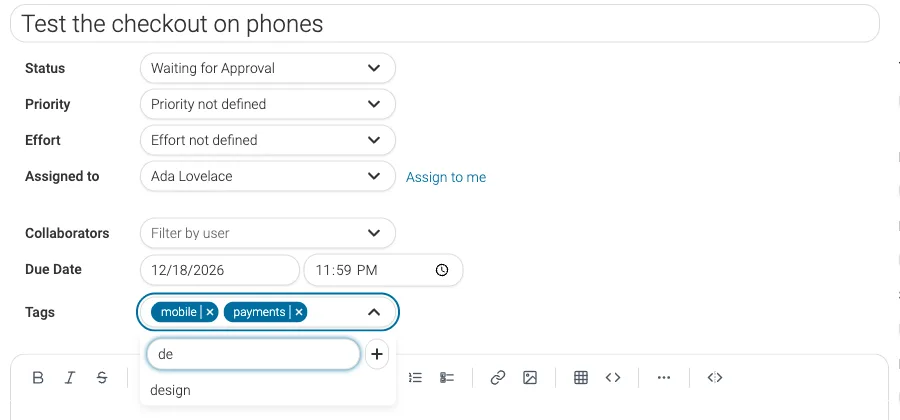
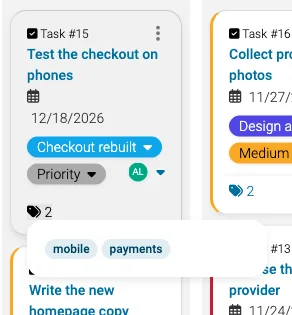

# Tags

Tags are your own labels for to-dos, ideas and docs. Use them for anything that cuts across your milestones and statuses: a topic like `payments`, a team like `design`, or a kind of work like `quick win`. Then you can pull up everything with that label in one search.

## How do I add a tag?

**On a to-do:**

1. Open the to-do. **Tags** is on the **Details** tab, under **Due Date**.
2. Click the field and start typing. Leantime suggests tags already used in this project. Click one, or press **Enter** (or click **+**) to add what you typed as a new tag.
3. Click **Save**.

**On an idea:** open the idea. The tag field is under its name. Click **Save**.

**On a doc:** the tag field is under the doc's title while you edit it. Docs save on their own.

To remove a tag, click the **×** on it, then save the to-do or idea.

A tag can't contain a comma: Leantime turns it into a space.

## Which tags does Leantime suggest?

The ones already used on to-dos, ideas and docs in the same project. Each project has its own tags, so a tag from another project isn't suggested. A tag stops being suggested once nothing in the project uses it.

## Where do I see tags?

- **Kanban board:** a tag icon with a number at the bottom of the card. Click it to see the tags. To hide them, click **Cards** and switch off **Tags**.
- **Table view:** a **Tags** column. Click its header to sort by it.
- **Ideas board:** a tag icon with a number on the idea's card.
- **Docs:** under the doc's title.

## How do I find everything with a tag?

**To-dos in one project:** on the To-Dos page, click **Filter**, type the tag in **Search Term** and click **Search**. You get every to-do with that tag. The search term matches whole tags only, in any case: `payments` and `Payments` find the tag `payments`, `pay` doesn't. To-dos with the word in their title or description show up too.

**Everything, in all your projects:** use the search box at the top of every page. It finds to-dos, ideas and docs by their tags as well as their text.

## Can I rename or delete a tag everywhere?

No. Tags have no list or settings of their own: they live on each to-do, idea or doc. To rename one, filter by the tag and change it on each item. A tag you remove from every item is gone.

## When should I use a tag, and when something else?

| You want to | Use |
|---|---|
| Group work that leads to one result, with a date | A [milestone](using-leantime/roadmap-planning.md) |
| Plan what the team does in the next two weeks | A [sprint](using-leantime/sprints.md) |
| Track a value for every to-do, like a budget code or a cost | A [custom field](using-leantime/custom-fields.md) |
| Label work loosely, with as many labels as you like | Tags |

## Can I import tags?

Yes. A **Tags** column in a CSV file fills in the to-dos' tags. See [Import from Jira, Trello, Asana or a spreadsheet](using-leantime/import-csv.md).

## Related

- [To-Dos](using-leantime/task-management.md)
- [Ideas](using-leantime/idea-management.md)
- [Docs](using-leantime/docs.md)
