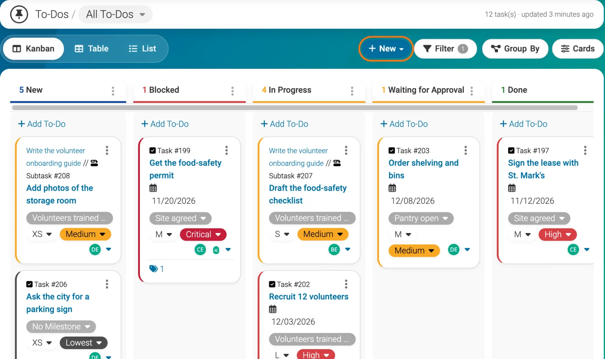
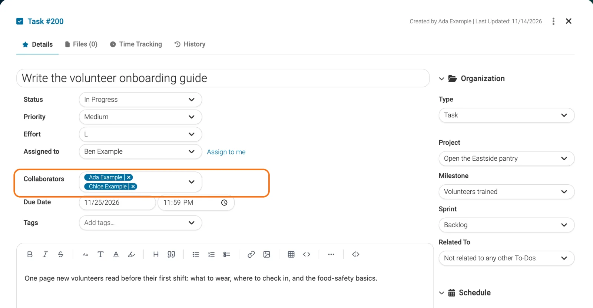
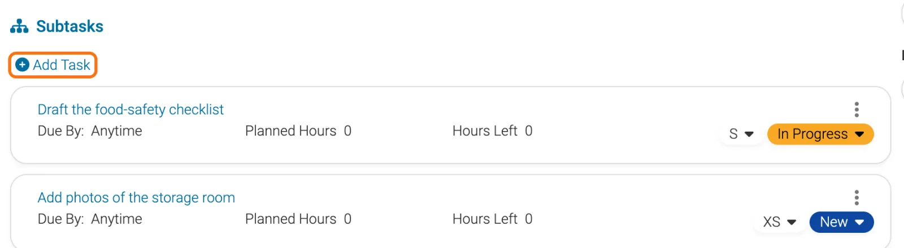
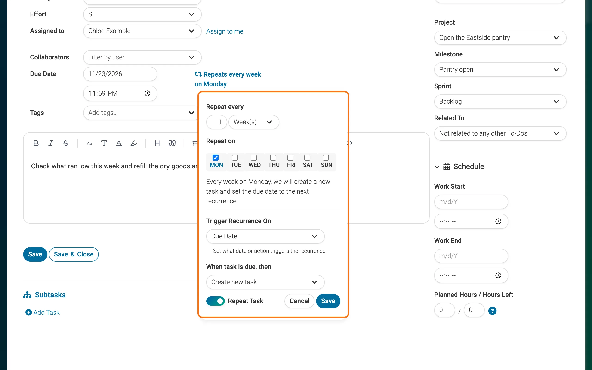
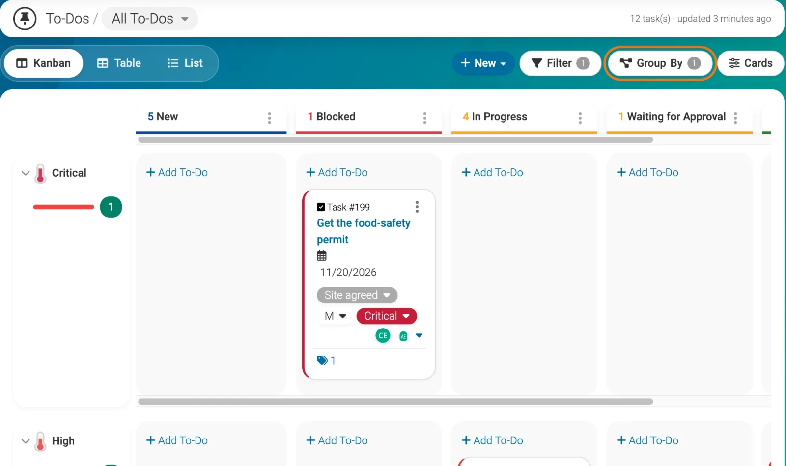
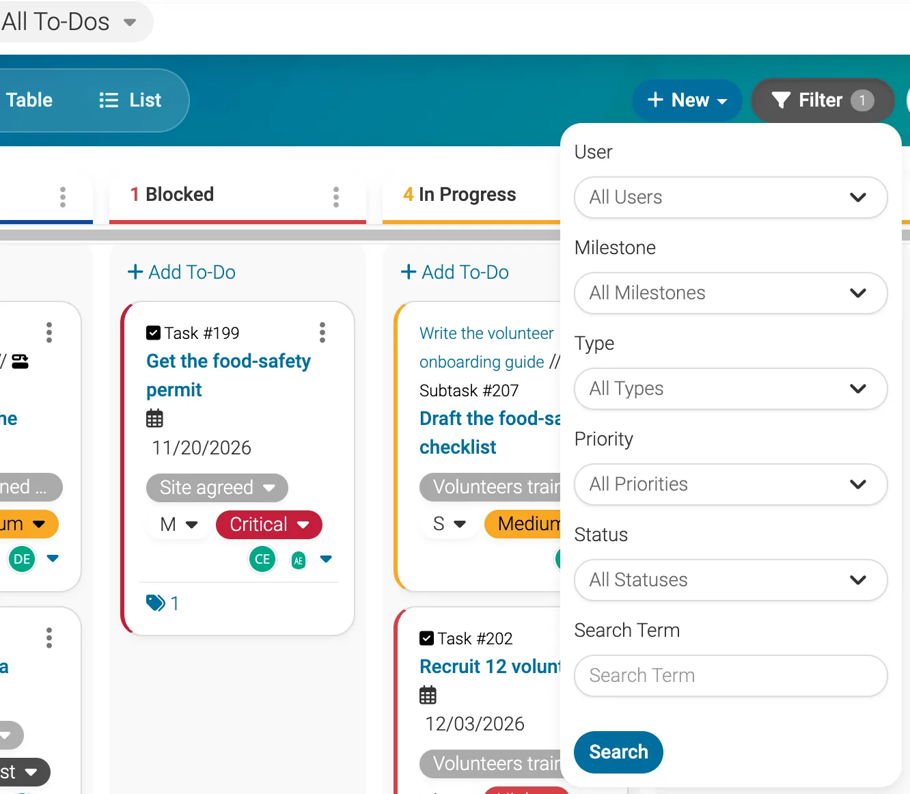
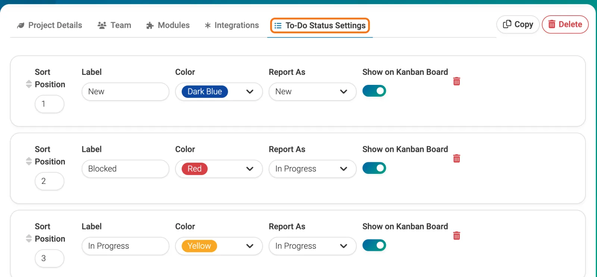

# To-Dos

To-Dos are the work in a project: each one has an owner, a status, a priority and a size, and can belong to a milestone. Open **To-Dos** in a project's menu to see them as a [Kanban](knowledge-base/kanban.md) board, a table or a list. Break bigger to-dos into subtasks, add collaborators who need to follow along, and group the board into swimlanes when it gets busy.

## How do I add a to-do in Leantime?

- **From anywhere on the page:** click **+ New → Add To-Do**. A window opens where you fill in everything at once.
- **Straight into a column:** click **Add To-Do** at the top of a Kanban column, type the title and press **Enter**. **Shift+Enter** saves it and starts the next one, **Esc** cancels. The to-do starts in that column's status and is assigned to you.
- **In the List view:** type in the **Create new task** box.

Adding to-dos needs the Editor role or higher.

## What's on a to-do?

Click a to-do's title to open it. The **Details** tab holds everything about it:

| Field | What it's for |
| --- | --- |
| **Status** | Where the work is: New, In Progress, Done and so on (see [How do I change the statuses?](#how-do-i-change-the-statuses)) |
| **Priority** | Critical, High, Medium, Low or Lowest |
| **Effort** | How big it is: < 2min, XS, S, M, L, XL or XXL |
| **Assigned to** | The one person who owns it. **Assign to me** takes it yourself. |
| **Collaborators** | Others who work on it or need to follow it |
| **Due Date** | When it's due, with an optional time |
| **Tags** | Your own labels, to find related to-dos |
| **Type**, **Project**, **Milestone**, **Sprint**, **Related To** | Under **Organization**: what kind of to-do it is (Task, Subtask, Story or Bug), which project and milestone it belongs to, which sprint, and which to-do it's part of |
| **Work Start**, **Work End**, **Planned Hours / Hours Left** | Under **Schedule**: when you plan to work on it and how long it should take |

Below the form are the to-do's **Subtasks** and the **Discussion**, where your team comments and @mentions each other. The other tabs hold the to-do's **Files** (see [Files](using-leantime/files.md#how-do-i-attach-a-file-to-a-to-do)), its **Time Tracking** and its **History**.

## Can a to-do have more than one person?

A to-do has one **assignee**, who owns it, so it's always clear who moves it forward. Anyone else who works on it or needs to follow it goes in **Collaborators**.

- **The assignee** gets an "Assigned to you" notification, unless they assigned it to themselves.
- **Collaborators** are told when the to-do is created, changed or moves to another status, even if their [notification settings](using-leantime/notifications.md) would otherwise hide that project's updates.
- **Anyone you @mention** in a comment or the description is notified too.

If several people each do a separate part, give each part its own subtask and assignee.

## How do I break a to-do into subtasks?

1. **Open the to-do** and scroll to **Subtasks**.
2. **Click Add Task,** type what needs doing, and click **Save**.

A subtask is a to-do of its own: it has its own assignee, status, effort and due date, and it inherits its parent's project, milestone and sprint. Change its status right in the list; open it to change the rest. On the Kanban board, subtasks are separate cards, with the parent's name above the title, and the parent's card shows how many subtasks it has.

To make an existing to-do a subtask of another one, pick the parent under **Organization → Related To**.

## Can one to-do depend on another?

Leantime links to-dos in one way: a subtask belongs to its parent (**Related To**). There's no separate "depends on" or "blocked by" link between two to-dos.

- **Waiting on something?** Move the to-do to **Blocked**, and say what it's waiting for in a comment.
- **One stage can't start before another ends?** Use milestones. A milestone can **depend on** another milestone, and the Milestones timeline draws an arrow between them (see [Milestones](using-leantime/roadmap-planning.md)).
- **Work that has to happen in order inside one to-do?** Break it into subtasks and work through them.

## How do I make a to-do repeat?

Some work comes back on a schedule: restocking every Monday, a report at the end of every month, a check-in every two weeks. Set the to-do up to repeat once instead of adding it again each time.

Repeating to-dos come with the Recurring Tasks plugin. On Leantime Cloud it's already on; on your own server, see [Recurring to-dos](plugins/recurring-todos.md) to install it.

1. **Open the to-do** and click **Recurring** (↻), next to **Due Date**.
2. **Switch on Repeat Task.**
3. **Set Repeat every:** a number, and **Day(s)**, **Week(s)**, **Month(s)** or **Year(s)**. Every two weeks is "2 Week(s)"; every quarter is "3 Month(s)".
4. **For weeks, tick the days** under **Repeat on**. For months, choose the day of the month.
5. **Choose what starts the next one** under **Trigger Recurrence On** (see below).
6. **Choose what happens:** **Create new task** adds a new to-do each time; **Reset status to 'New'** reuses the same to-do.
7. **Click Save.**

The link next to **Due Date** now describes the schedule, like "Repeats every week on Monday". You also find the ↻ icon on the to-do's card on the Kanban board and in **My ToDos** on your dashboard.

Setting up a repeat needs the Editor role or higher in the project.

### When is the next one created?

It depends on **Trigger Recurrence On**:

| Trigger | When the next one comes |
| --- | --- |
| **Due Date** | When the next due date arrives. The copy is created then, already due, not ahead of time. |
| **Scheduled Start Date** | When the next start date arrives, counted from the to-do's **Work Start** date. |
| **Task is set to done** | Shortly after someone moves it to a Done status, so the next one only comes once this one is finished. |

The new to-do is a copy: same title, description, assignee, project and milestone, starting in **New**. Each copy shows up as a subtask of the first to-do (or of its parent, if the first to-do is a subtask itself), so the repeats stay together. With **Reset status to 'New'**, the same to-do goes back to **New** instead; with the **Due Date** or **Scheduled Start Date** trigger, its date moves to the next time too.

### How do I stop a to-do from repeating?

With **Create new task**, the schedule moves to each new copy. So open the most recent to-do in the series, click the ↻ link next to **Due Date**, switch off **Repeat Task** and click **Save**. To-dos that were already created stay. Change the schedule the same way.

Deleting the most recent to-do in the series also stops it from repeating.

## Can I add my own fields to a to-do?

Yes, for the details your team tracks that Leantime doesn't have a field for, like a budget code or a cost estimate. An Admin or Owner sets them up once, and they show on a **Custom Fields** tab on the to-do. See [Custom Fields](using-leantime/custom-fields.md).

## Which views can I use?

Switch between them at the top left of the To-Dos page. Leantime opens the one you used last.

- **Kanban:** a column per status. Drag a card to change its status. Change a card's milestone, effort, priority or assignee from its chips, without opening it. **Cards** chooses what each card shows and how cards are sorted.
- **Table:** one row per to-do, with columns you can sort and hide (**Columns**), and **Export** to a CSV file.
- **List:** to-dos on the left; click one to edit it on the right.

The timeline isn't here: it's under **Milestones** in the project menu, where **Show Tasks** adds to-dos to it.

## How do I use swimlanes?

Swimlanes split the Kanban board into rows, so a busy board is easier to scan. Click **Group By** and choose what each row stands for:

- **Priority**, **Effort**, **Type** or **Milestone**
- **User:** one row per assignee
- **Sprint**
- **Due Date:** Overdue, Due This Week, Due Next Week, Due Later and No Due Date
- **Parent Task:** a row for each to-do's subtasks, named after the parent. Subtasks of subtasks go under the top-level parent. To-dos without a parent, including the parents themselves, stay in **No Parent Task**.

Click a row's name to collapse it. **Add To-Do** inside a row fills in that row's value for you, like the priority, the assignee or the milestone. Two exceptions: in a **Parent Task** row the new to-do isn't a subtask (add subtasks from the parent's **Subtasks** section, or set **Related To**), and in the **Overdue** row it gets today's date, so it moves to **Due This Week**. Grouping is just a view: choose **No Grouping** to go back, and nothing about your to-dos changes. In the Table and List views you can also group by **Status**.

## How do I filter or find to-dos?

Click **Filter** and choose a **User**, **Milestone**, **Type**, **Priority** or **Status**, or type a **Search Term**, then click **Search**. The number on the button shows how many filters are on. **Not Done** under Status hides finished work.

To find a to-do in any project, use the search box at the top of every page.

## How do I change the statuses?

Every project starts with **New**, **Blocked**, **In Progress**, **Waiting for Approval** and **Done**, plus **Archived**, which is hidden from the board.

To rename, add, reorder or hide statuses, open **Project Settings → To-Do Status Settings**. For each status you set its label, color, whether it shows on the Kanban board, and how Reports count it (**Report As**: New, In Progress, Done, or not at all). A to-do in a status reported as Done counts as finished in Reports and milestone progress. If you move it there while your timer runs on it, your timer stops; other people's timers keep running. **Archived** can't be renamed or removed. You need the Manager role or higher.

The **⋮** menu on a Kanban column has the same options for that column: **Edit Label** and **Add/Remove Columns**.

## How do I move a to-do to another project?

Open the to-do's **⋮** menu and choose **Move To-Do**, then pick the project. Its sprint, milestone and parent are cleared, because they belong to the old project. You need edit rights in both projects.

## How do I delete a to-do?

Open the to-do's **⋮** menu, on its card on the board or at the top of the to-do, and choose **Delete To-Do**. Then click **Yes, delete!** Deleting can't be undone. You need the Editor role or higher.

**"Task has timesheets attached":** Leantime doesn't delete a to-do that has time logged on it, so the hours stay in your timesheets and reports. Either delete its time entries first, or move the to-do to the **Archived** status instead. You can delete your own entries (see [How do I fill in a week at a time?](using-leantime/timesheets.md#how-do-i-fill-in-a-week-at-a-time)). Entries other people logged can only be deleted by them, or by a Company Manager, Administrator or Owner from **Company → All Timesheets** (see [How do I see everyone's time?](using-leantime/timesheets.md#how-do-i-see-everyones-time)). Archived to-dos are hidden from the board and keep their hours.

## How do I track time on a to-do?

Open the to-do's **⋮** menu and choose **Track Time → Start Work**; choose **Stop Work** when you're done. To log time afterwards, open the to-do's **Time Tracking** tab. Both need time tracking to be on for the project (see [Time tracking](using-leantime/timesheets.md)).

## What about sprints?

Sprints are optional. Use the menu next to **To-Dos** at the top of the page to **Create Sprint**, or to switch between **All To-Dos**, the **Backlog** and each sprint. A to-do's **Sprint** field puts it in one. See [Sprints](using-leantime/sprints.md).

## Who can do what with to-dos?

| Role | To-dos |
| --- | --- |
| Read Only | See them |
| Commenter | Also comment and add files |
| Editor and above | Create, edit, move and delete them |
| Manager and above | Also change the project's statuses |

See [User Management](using-leantime/user-management.md) for the roles.

## Related

- [How should I organize my work?](getting-started/organize-your-work.md)
- [Milestones](using-leantime/roadmap-planning.md)
- [My Work Dashboard](using-leantime/my-work-dashboard.md)
- [Notifications](using-leantime/notifications.md)
