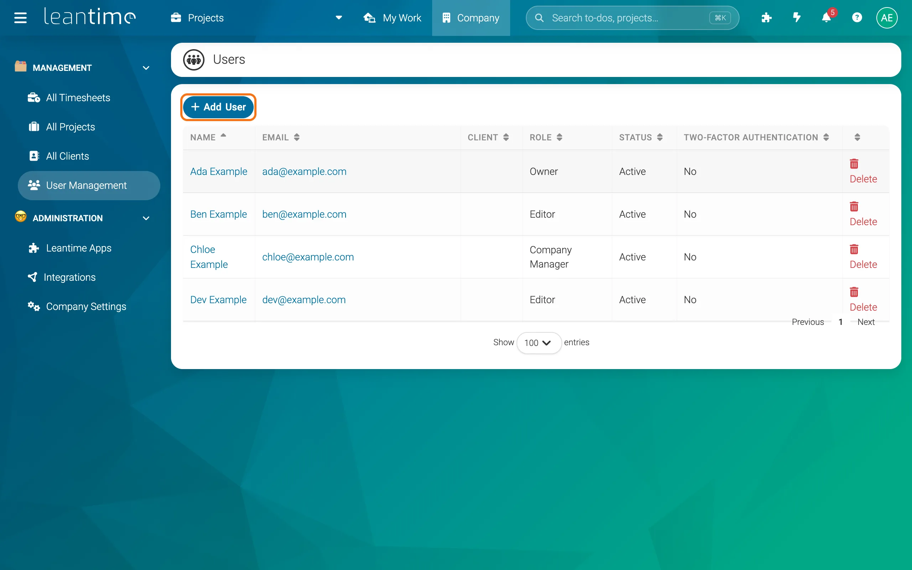
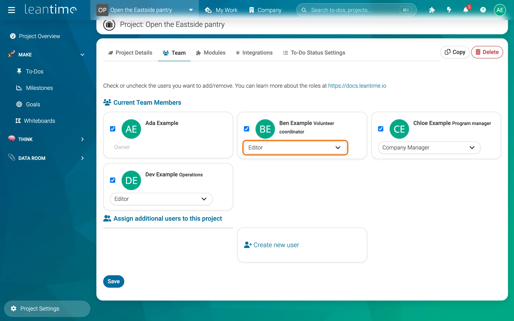
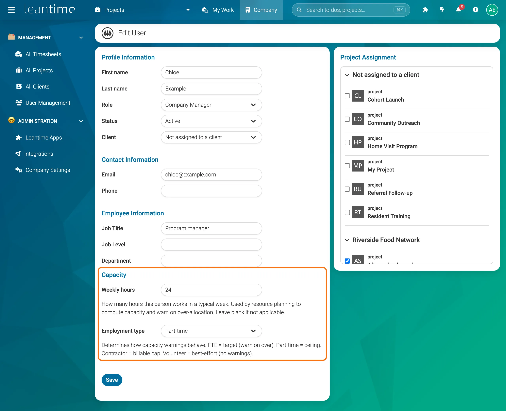

# User Management

Everyone who works in Leantime has a user account with a role. The role decides what they can do: look, comment, change things, or run the projects and the company. On each project you choose who's on the team, and you can give someone a different role there.

## How do I add someone to Leantime?

1. **Click Company** at the top of the page, then **User Management** in the left menu.
2. **Click Add User.**
3. **Fill in their first name, last name and email.** Job title, department and phone are optional.
4. **Choose their Role** (see [Roles](#roles)). You can only give a role up to your own.
5. **Optional:** choose a **Client**, and tick the projects they should join under **Project Assignment**.
6. **Click Invite User.**

Leantime emails them an invitation; they set their own password when they accept it. Until then, their status is **Invited**. To send the invitation again, or to copy the link and send it yourself, open their profile and use **Resend Invite** or **Copy Invitation Link**.

User Management needs the Administrator role or higher. A Company Manager can invite people from a project's **Team** tab instead (see below).

## How do I add someone to a project?

1. **Open the project**, click **Project Settings** at the bottom of the menu, and open the **Team** tab.
2. **Tick the people** under **Assign additional users to this project**. Untick someone under **Current Team Members** to take them off the project.
3. **Optional:** pick a different role for this project from the dropdown on their card (see the next section).
4. **Click Save.**

Someone who isn't in Leantime yet? Click **Create new user** on the same tab to invite them, or **Invite User** in the **Team** box on the project's dashboard.

Changing a project's team needs the Company Manager role or higher.

## Who can see a project?

**Who can access this project?**, in the project's **Project Details**, decides who can open it. The project's team members can always open it; the other two options let more people in:

- **Only the users I choose under 'Team'** (the default): only the team members.
- **Everyone assigned to this client:** the team members, plus everyone whose user account has the project's client.
- **Everyone in this organization:** everyone with a Leantime account.

Administrators and Owners can open every project, whatever this is set to.

## Roles

Each person has one role for all of Leantime. Every role can do everything the roles below it can.

| Role | What they can do |
| --- | --- |
| **Read Only** | See the projects they're on: to-dos, milestones, goals, ideas, blueprints, docs and files |
| **Commenter** | Also comment, and upload files |
| **Editor** | Also create, change and delete to-dos, milestones, goals, ideas, blueprints and docs, and log their own time |
| **Company Manager** | Also create, change and delete projects, manage project teams, invite people to their projects, see and manage everyone's timesheets, and edit or delete anyone's comments |
| **Administrator** | Also see every project, manage all users and clients, install plugins, and change company settings |
| **Owner** | Everything |

### Can someone have a different role on one project?

Yes, for people whose company role is Editor or below. On the project's **Team** tab, pick their role for this project from the dropdown on their card. **Inherit** (the default) keeps their company role.

A project role can go up or down: a Commenter can be an Editor on one project, and an Editor can be Read Only on another. Company Managers, Administrators and Owners always keep their company role, on every project. Creating projects and changing project settings always depends on the company role.

## How do I change someone's role or details?

Open **Company → User Management** and click their name. Change their details, **Role**, **Client** or **Project Assignment**, and click **Save**.

## How do I set how many hours someone works?

Weekly hours tell Leantime how much time someone has to plan with. You set them once, on their user, and resource planning uses them everywhere.

1. **Open Company → User Management** and click their name.
2. **Under Capacity, enter their Weekly hours**, like 40. Use whole hours: 37.5 is saved as 38.
3. **Choose their Employment type.** It says what the hours mean:
   - **Full-time:** the hours they're expected to work.
   - **Part-time:** the most hours they've agreed to work.
   - **Contractor:** the most hours you can bill for.
   - **Volunteer:** the hours they can give, as best they can.
4. **Click Save.**

Both fields are optional and start empty. Only people who can edit users see them: the Administrator role or higher.

**Where are the hours used?** In the **Resources** page of the Programs plugin, where you plan people across a program's projects. It shows each person's weekly hours and employment type, adds up the hours they're booked for on every project, in this program and others, and flags anyone booked for more than their hours. Without weekly hours on their user, a planner types each person's hours on the Resources page instead. On the Leantime Marketplace the plugin is called [Program Plans](https://marketplace.leantime.io/product/leantime-program-plans/); it's already on in Leantime Cloud.

## How do I deactivate or delete someone?

- **Deactivate:** open their profile, set **Status** to **Deactivated** and click **Save**. They can't sign in anymore, and their to-dos, comments and time entries stay as they were. Set them back to **Active** any time.
- **Delete:** click **Delete** next to their name on the User Management page, and confirm. Use this only for accounts that should go completely; when someone leaves, deactivating keeps your history readable.

Both need the Administrator role or higher.

## What about two-factor authentication?

The **Two-Factor Authentication** column shows who has it on. Each person turns it on or off under their own profile; an administrator can't do it for them.

## Related

- [Clients](using-leantime/managing-clients.md)
- [Projects](using-leantime/managing-projects.md)
- [Authentication](installation/authentication-configuration.md): signing in with OIDC or LDAP
